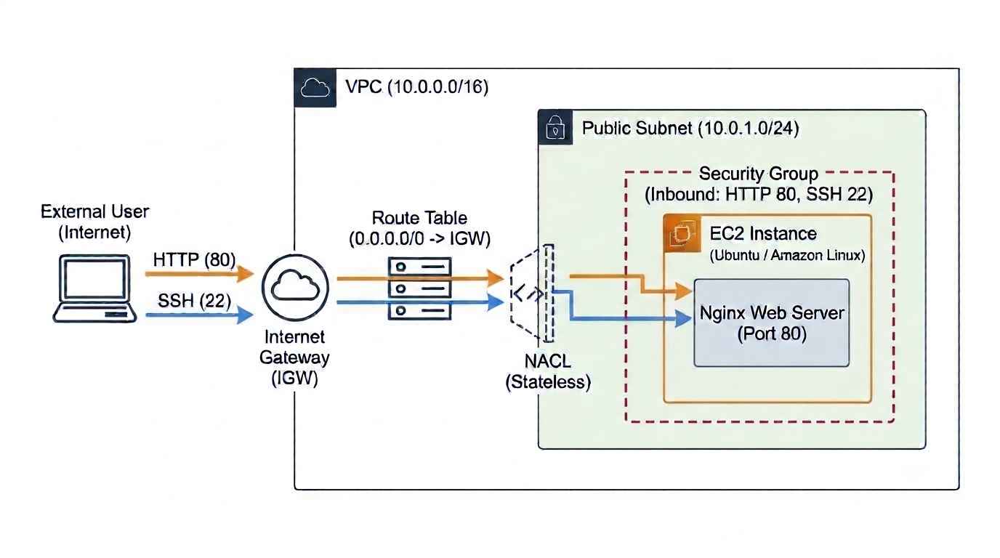
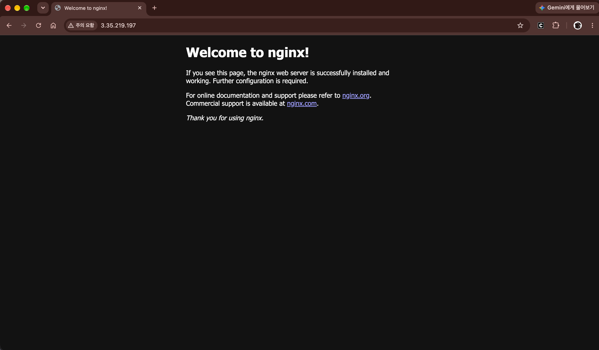
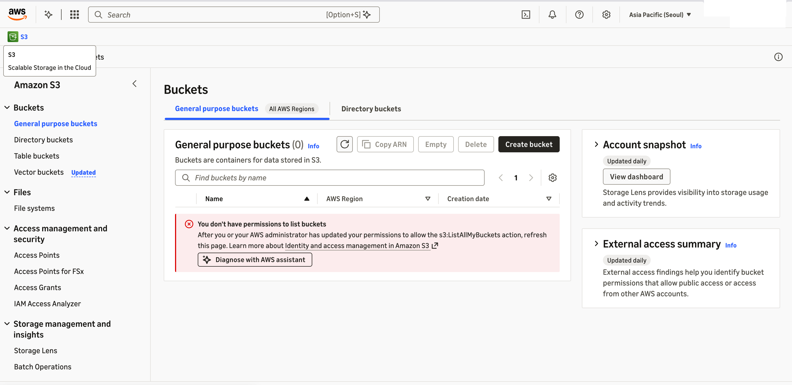
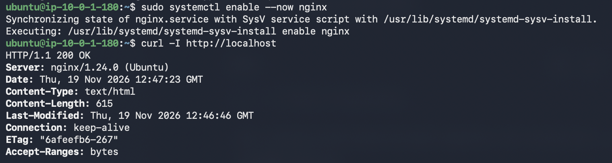

# AWS VPC 기반 최소권한 웹 서버(Nginx) 구축 실습

## 1. 프로젝트 개요
AWS 서울 리전(`ap-northeast-2`) 환경에서 최소권한 원칙(Least Privilege)을 적용한 IAM 사용자 계정을 생성하고, 독립된 가상 네트워크(VPC) 위에 EC2 웹 서버(Nginx)를 구축하여 외부 HTTP 접속을 검증한 프로젝트입니다.

---

## 2. 인프라 아키텍처 및 네트워크 흐름

### 외부 → EC2 트래픽 흐름 (요청 및 응답)
1. **외부 클라이언트 → Internet Gateway (`codyssey-b3-igw`)**: 사용자가 `http://<EC2_PUBLIC_IP>`로 HTTP(80) 요청을 보내면 VPC 외부 관문인 IGW로 진입합니다. (IGW가 퍼블릭 IP ↔ EC2 사설 IP 간 1:1 NAT 수행)
2. **IGW → Route Table (`codyssey-b3-public-rt`) → Public Subnet (`codyssey-b3-public-subnet`)**: VPC 내부 대역(`10.0.0.0/16`) 목적지에 따라 서브넷(`10.0.1.0/24`)으로 라우팅되고 서브넷 단위 NACL(Stateless)을 통과합니다.
3. **Public Subnet → Security Group (`codyssey-b3-sg`) → EC2 (`codyssey-b3-web` / Nginx:80)**: 인스턴스 단위 보안 그룹이 `TCP 80` 인바운드를 허용하면 Nginx(`0.0.0.0:80`)가 요청을 수신해 페이지를 응답합니다.
4. **응답 반환 (EC2 → SG → Route Table → IGW → 외부)**: Security Group은 상태 저장(Stateful)이므로 허용된 요청의 응답을 자동 통과시키며, `codyssey-b3-public-rt`의 기본 경로(`0.0.0.0/0 → IGW`)를 타고 외부 클라이언트로 반환됩니다.

### 주요 구성 요소 및 설계 의도
* **IAM (`codyssey-b3-user`):** 실습에 필요한 `ec2:*` 권한만 부여하고, S3·Billing 등 무관한 서비스 접근을 차단하여 보안 사고 및 무단 과금 리스크 최소화
* **VPC (`codyssey-b3-vpc` / `vpc-034b5706323a9ae56` / `10.0.0.0/16`):** 논리적으로 격리된 독립 네트워크 환경 구성
* **Public Subnet (`codyssey-b3-public-subnet` / `subnet-0596ba99f3ced2352` / `10.0.1.0/24`):** `ap-northeast-2a` 가용 영역에 배치하고 퍼블릭 IPv4 자동 할당 활성화
* **Internet Gateway & Route Table (`codyssey-b3-igw` / `igw-00b370169494f4c21`, `codyssey-b3-public-rt` / `rtb-0d7f783cf58b5f7de`):** 기본 경로(`0.0.0.0/0 → IGW`)를 추가하고 서브넷을 명시적 연결. 이 경로가 없으면 인바운드 요청에 대한 응답 반환과 EC2 내부의 아웃바운드 통신(`apt install`, `curl https://example.com`)이 모두 실패함
* **Security Group (`codyssey-b3-sg` / `sg-0cf396a7a01c073eb`):** `HTTP(80)`(`0.0.0.0/0`)과 `SSH(22)`(`내 IP/32`, `curl -s ifconfig.me` 또는 콘솔 `My IP`로 확인)만 최소 허용
* **EC2 & Web Server (`codyssey-b3-web` / `i-0ffee0600f2ebacd2`):** Ubuntu Server 프리 티어(`t3.micro`)에 Nginx 웹 서버 구동

---

## 3. 보안 설계 원칙 (SG vs IAM, 최소 권한 및 점진적 권한 확대)

### Security Group vs IAM 책임 범위 비교
| 구분 | Security Group (네트워크 계층) | IAM (API·리소스 권한 계층) |
| --- | --- | --- |
| **책임 범위** | EC2 인스턴스 단위 **네트워크 트래픽 제어** (가상 방화벽, Stateful) | AWS 서비스·리소스에 대한 **인증 및 API 작업 인가 통제** |
| **제어 대상** | 인바운드/아웃바운드 IP, 프로토콜, 포트 | 사용자·역할이 호출 가능한 AWS API 액션(`ec2:*`, `s3:*` 등) 및 리소스 ARN |
| **실습 적용** | `codyssey-b3-sg` (`80`, `22` 포트만 허용) | `codyssey-b3-user` (`ec2:*`만 허용, S3·Billing 차단) |

### 보안 그룹 허용/차단 기준 및 `0.0.0.0/0` 개방 위험성·대안
* **허용 기준:** 서비스 필수 포트(`HTTP 80` → `0.0.0.0/0`)와 관리자 원격 접속(`SSH 22` → `<내 공인 IP>/32`)만 화이트리스트 허용
* **차단 예시:** TLS 미구성 `HTTPS(443)`, 실습 범위 외 `DB 포트(3306, 5432)`, 전체 개방(`0-65535`) 전면 차단
* **`0.0.0.0/0` 개방 위험:** `SSH(22)`나 DB 포트를 전 세계(`0.0.0.0/0`)에 열면 배포 직후 자동화 봇의 무차별 대입 공격(Brute-force), 취약점 스캔, 민감 데이터 탈취의 표적이 됨
* **안전한 대안:**
  * **SSH:** `<내 공인 IP>/32` 단일 제한, **AWS Systems Manager Session Manager(SSM)**(22 포트 미개방), 또는 VPN/Bastion Host 경유
  * **DB:** Private Subnet 배치 + DB 보안 그룹 인바운드 소스를 **웹 서버 Security Group ID(`sg-xxxx`)**로만 제한

### IAM 권한 부족(`AccessDenied`) 시 점진적 최소 권한 확대 절차
권한 부족 오류가 발생하더라도 `AdministratorAccess` 같은 광범위한 권한을 부여하지 않고 아래 순서로 최소 범위만 추가합니다.
1. **에러 메시지 분석:** `AccessDenied` 응답에 표시된 정확한 누락 액션명(예: `ec2:DescribeRouteTables`)과 리소스 ARN 확인
2. **CloudTrail 및 Policy Simulator 활용:** 메시지가 불명확하면 CloudTrail 이벤트 기록에서 거부된 API를 추적하고, IAM Policy Simulator로 정책 사전 검증
3. **단계적 최소 부여:** 식별된 액션만 특정 리소스·리전 조건으로 제한해 정책에 추가하고, 작업이 성공하는 최소 지점에서 중단

---

## 4. 구축 증빙 및 외부 웹 접속 검증 결과

* **선택한 검증 방식 (A/B 택 1):** **(A) 브라우저로 `http://<퍼블릭IP>` 접속 시 웹 페이지 정상 로딩 확인**
  * *(선택 근거 및 구성 절차: Public Subnet 퍼블릭 IPv4 자동 할당 → `0.0.0.0/0 → IGW` 라우팅 연결 → SG `HTTP 80` 허용 → Ubuntu EC2에 Nginx 설치·구동 후 외부 브라우저로 전 구간 통신 검증. 참고: B안 선택 시 Nginx 설정에 `location /health { return 200 "OK\n"; }` 추가 후 `curl -i http://<퍼블릭IP>/health`로 검증 가능)*
* **SSH 접속 검증:** `ssh -i codyssey-b3-key.pem ubuntu@<EC2_PUBLIC_IP>` 접속 성공 ([connected_ec2.png](docs/images/connected_ec2.png))
* **내부 통신 검증:** `curl -I http://localhost` -> `HTTP/1.1 200 OK`
* **아웃바운드 검증:** `curl -I https://example.com` -> `HTTP/2 200`
* **외부 브라우저 접속:** Chrome에서 `http://<EC2_PUBLIC_IP>` 접속 시 `Welcome to nginx!` 정상 출력 및 서버 `/var/log/nginx/access.log`의 `"GET / HTTP/1.1" 200` 기록 확인

### 단계별 구축 증빙
* **IAM 최소권한 정책 확인 (S3 접근 차단)**
  
* **VPC 리소스 맵 연결 확인 (`codyssey-b3-public-subnet` → `codyssey-b3-public-rt` → `codyssey-b3-igw`)**
  
* **보안 그룹 인바운드 규칙 확인 (HTTP 80 / SSH 22 내 IP `/32` 제한)**
  
* **EC2 SSH 접속 확인**
  
* **Nginx 설치 및 로컬 응답 확인**
  

---

## 5. 확장성 설계 및 비용 추적·정리 기준

### 트래픽 증가 시 2대 확장 전략 (병목 진단 및 ALB 도입)
* **현재 구조의 병목 및 위험:** 단일 EC2의 CPU/메모리/네트워크 처리 한계, 단일 AZ(`ap-northeast-2a`)로 인한 단일 장애점(SPOF), 복수 인스턴스 간 트래픽 분산 진입점 부재
* **병목 확인 지표:** CloudWatch `CPUUtilization`(지속 70~80% 이상), `NetworkIn/Out`, Nginx 응답 지연 및 5xx 에러율
* **확장 아키텍처:**
  1. **멀티 AZ 서브넷 구성:** 최소 2개 AZ(`ap-northeast-2a`, `ap-northeast-2c`)에 서브넷 배치
  2. **ALB (Application Load Balancer) + Target Group 도입:** 단일 진입점에서 헬스 체크(`/health`)로 정상 EC2 2대에 트래픽 자동 분산
  3. **Auto Scaling Group (ASG):** 지표 기반 자동 수평 확장 및 Private Subnet 배치(EC2 SG 80 포트는 ALB SG ID만 허용)

### 리소스 추적·정리 및 이상 과금 대응
* **네이밍 및 태그 규칙:** 모든 실습 리소스에 공통 접두사 `codyssey-b3-*`와 `Name` 태그를 적용해 일괄 식별·추적 *(운영 환경 확장 시 `Owner`, `Environment`, `CostCenter`, `Project` 태그 병행 권장)*
* **정리 기준:** [리소스 정리 체크리스트](docs/cleanup-checklist.md) 기준으로 의존성 역순(EC2 → SG/Key Pair → IGW → Subnet → Route Table → VPC) 삭제 및 잔여 리소스 `0`건 확인
* **예상치 못한 Billing 과금 대응:**
  1. **1차 의심 리소스:** 중지(`Stop`) 상태 EC2, 고아 EBS 볼륨/스냅샷, 미연결 Elastic IP(IPv4 과금), NAT Gateway·ALB·RDS
  2. **추적·정리:** `Billing > Bills / Cost Explorer`에서 서비스·리전·사용 유형(Usage Type)별 필터링 → `Tag Editor / Resource Explorer`로 타 리전(`us-east-1` 등) 포함 전수 검색 및 삭제 → `AWS Budgets` 예산 알림 설정

---

## 6. 산출물 목록
* [아키텍처 다이어그램](docs/architecture.png)
* [트러블슈팅 보고서](docs/troubleshooting.md)
* [리소스 정리 체크리스트](docs/cleanup-checklist.md)
