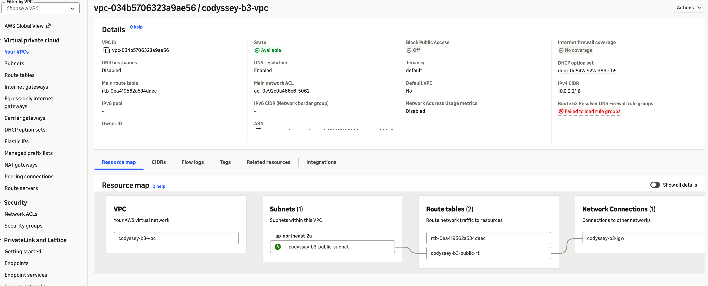
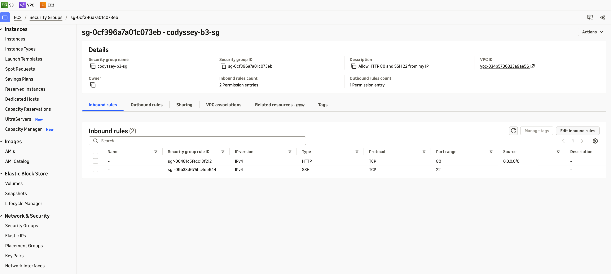
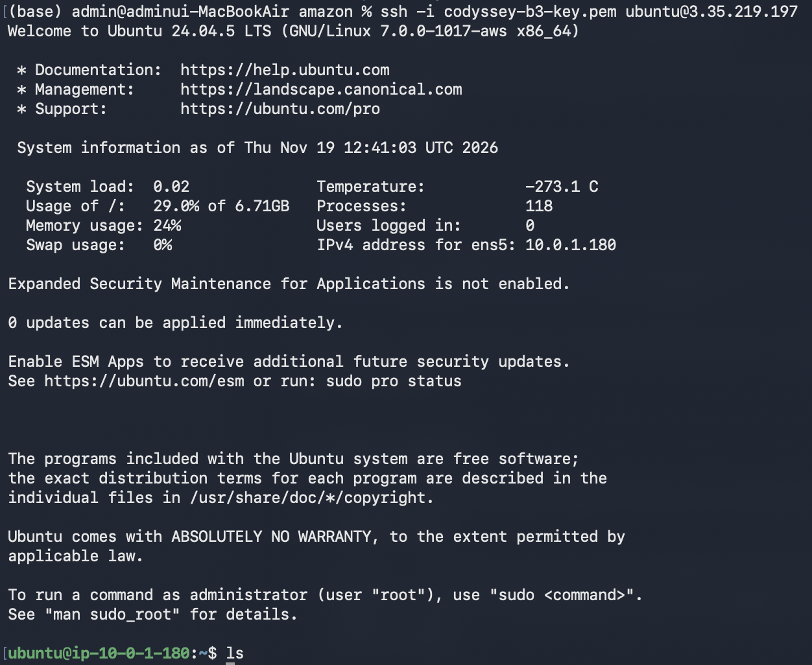

# AWS VPC 기반 최소권한 웹 서버(Nginx) 구축 실습

## 1. 프로젝트 개요
AWS 서울 리전(`ap-northeast-2`) 환경에서 최소권한 원칙(Least Privilege)을 적용한 IAM 사용자 계정을 생성하고, 독립된 가상 네트워크(VPC) 위에 EC2 웹 서버(Nginx)를 구축하여 외부 HTTP 접속을 검증한 프로젝트입니다.

## 2. 인프라 아키텍처

### 주요 구성 요소 및 설계 의도
* **IAM (`codyssey-b3-user`):** 실습에 필요한 `ec2:*` 권한만 부여하고, 불필요한 S3 등의 서비스 접근을 차단하여 보안 사고 및 무단 과금 리스크 최소화
* **VPC (`codyssey-b3-vpc` / `10.0.0.0/16`):** 논리적으로 격리된 독립 네트워크 환경 구성
* **Public Subnet (`codyssey-b3-public-subnet` / `10.0.1.0/24`):** `ap-northeast-2a` 가용 영역에 배치하고 퍼블릭 IPv4 자동 할당 활성화
* **Internet Gateway & Route Table (`codyssey-b3-igw`, `codyssey-b3-public-rt`):** 외부 인터넷 트래픽(`0.0.0.0/0`)을 IGW로 라우팅하여 양방향 통신 개통
* **Security Group (`codyssey-b3-sg`):** 인바운드 규칙에서 웹 서비스용 `HTTP(80)`(`0.0.0.0/0`)와 관리자 원격 접속용 `SSH(22)`(`내 IP/32`)만 최소 허용
* **EC2 & Web Server (`codyssey-b3-web`):** Ubuntu Server 기반 프리 티어 인스턴스에 Nginx 웹 서버 구동

## 3. 구축 증빙 및 외부 웹 접속 검증 결과
* **선택한 검증 방식:** **(A) 브라우저로 `http://<퍼블릭IP>` 접속 시 웹 페이지 정상 로딩 확인**
* **내부 통신 검증:** `curl -I http://localhost` -> `HTTP/1.1 200 OK`
* **아웃바운드 검증:** `curl -I https://example.com` -> `HTTP/2 200`
* **외부 브라우저 접속:** Chrome에서 `http://<EC2_PUBLIC_IP>` 접속 시 `Welcome to nginx!` 정상 출력 확인

### 단계별 구축 증빙
* **IAM 최소권한 정책 확인**
  
* **VPC 리소스 맵 연결 확인**
  
* **보안 그룹 인바운드 규칙 확인 (HTTP 80 / SSH 22 내 IP 제한)**
  
* **EC2 SSH 접속 확인**
  
* **Nginx 설치 및 로컬 응답 확인**
  

## 4. 리소스 추적 및 정리 기준
* **네이밍 및 태그 규칙:** 모든 실습 리소스에 공통 접두사 `codyssey-b3-*`를 적용하고 `Name` 태그(`codyssey-b3-vpc`, `codyssey-b3-public-subnet`, `codyssey-b3-igw`, `codyssey-b3-public-rt`, `codyssey-b3-sg`, `codyssey-b3-web`, `codyssey-b3-key`)로 일괄 식별·추적
* **정리 기준:** 과금 방지 및 의존성 오류 예방을 위해 [리소스 정리 체크리스트](docs/cleanup-checklist.md) 기준으로 의존성 역순(EC2 → SG/Key Pair → IGW → Subnet → Route Table → VPC) 삭제 및 잔여 리소스 `0`건 확인

## 5. 산출물 목록
* [아키텍처 다이어그램](docs/architecture.png)
* [트러블슈팅 보고서](docs/troubleshooting.md)
* [리소스 정리 체크리스트](docs/cleanup-checklist.md)
