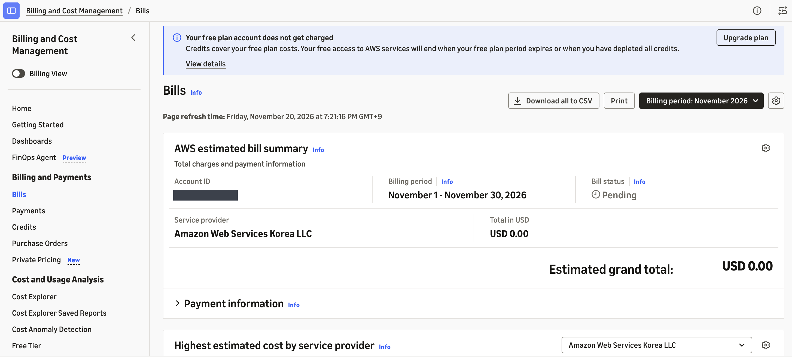

# AWS 리소스 정리 및 과금 방지 체크리스트

실습 종료 후 불필요한 비용 발생을 방지하기 위해 생성한 모든 AWS 리소스를 의존성 역순으로 삭제하고 상태를 점검했습니다.

## 1. 리소스 삭제 체크리스트 (서울 리전: `ap-northeast-2`)
- [x] **EC2 인스턴스 종료(Terminate):** `codyssey-b3-web` 인스턴스 종료 실행 및 상태가 `종료됨(Terminated)`으로 변경됨을 확인 *(주의: '중지(Stop)'가 아닌 반드시 '종료(Terminate)' 수행)*
  - 증빙: [01_terminate_EC2.png](images/cleanup-checklist-images/01_terminate_EC2.png)
- [x] **보안 그룹(Security Group) 삭제:** `codyssey-b3-sg` 삭제 완료 *(EC2 인스턴스가 완전히 종료된 후 삭제 가능)*
  - 증빙: [02_delete_security-groups.png](images/cleanup-checklist-images/02_delete_security-groups.png)
- [x] **키 페어(Key Pair) 삭제:** EC2 콘솔에서 `codyssey-b3-key` 삭제 완료
  - 증빙: [03_delete_Key-pairs.png](images/cleanup-checklist-images/03_delete_Key-pairs.png)
- [x] **인터넷 게이트웨이(IGW) 분리 및 삭제:** `codyssey-b3-igw`를 VPC에서 분리(Detach) 후 삭제(Delete) 완료
  - 증빙: [04_delete_IGW.png](images/cleanup-checklist-images/04_delete_IGW.png)
- [x] **서브넷(Subnet) 삭제:** `codyssey-b3-public-subnet` 삭제 완료
  - 증빙: [05_delete_subnet.png](images/cleanup-checklist-images/05_delete_subnet.png)
- [x] **라우팅 테이블(Route Table) 삭제:** 사용자 정의 라우팅 테이블 `codyssey-b3-public-rt` 삭제 완료
  - 증빙: [06_delete_route-tables.png](images/cleanup-checklist-images/06_delete_route-tables.png)
- [x] **VPC 삭제:** `codyssey-b3-vpc` 삭제 완료 *(삭제 시 기본 라우팅 테이블 및 기본 NACL 자동 삭제됨)*
  - 증빙: [07_delete_VPC.png](images/cleanup-checklist-images/07_delete_VPC.png)

## 2. 최종 과금 및 잔여 리소스 점검
- [x] **EC2 대시보드 확인:** 실행 중인 인스턴스 `0`, 볼륨(EBS) `0`, 탄력적 IP(Elastic IP) `0`, 키 페어 `0` 확인
  
- [x] **AWS Billing & Cost Management 확인:** 결제 대시보드에서 예상 청구 금액 `USD 0.00` 확인
  
