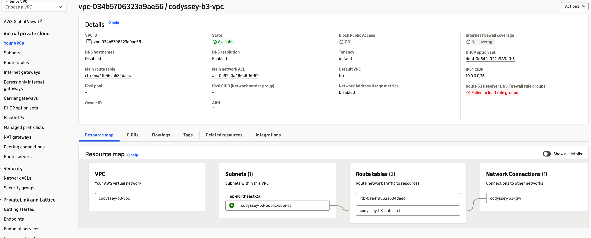
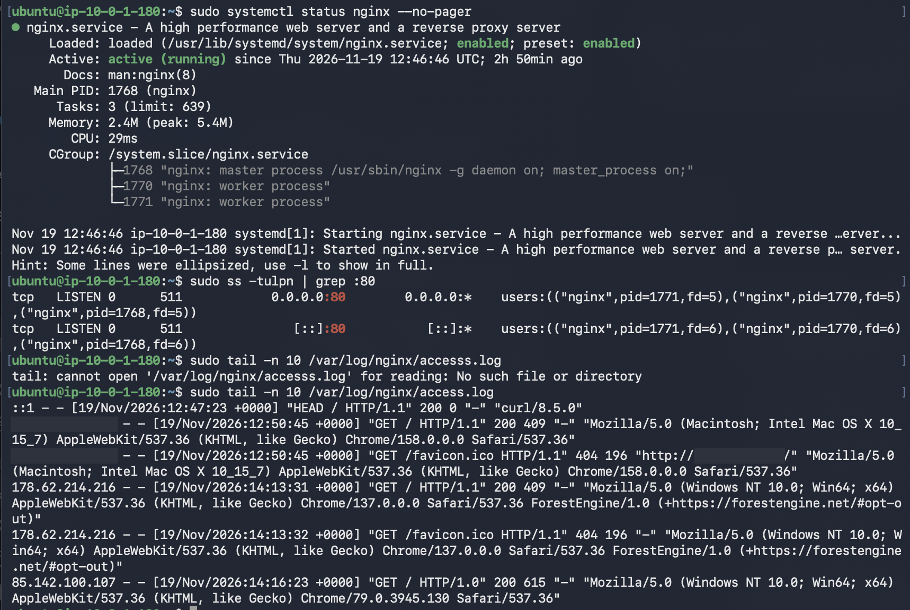

# 트러블슈팅 보고서 (Troubleshooting Report)

## 사례 1: 서브넷과 사용자 정의 라우팅 테이블 연결 누락

### 1. 증상 (Symptom)
* `codyssey-b3-public-rt` 라우팅 테이블에 `0.0.0.0/0 -> codyssey-b3-igw` 경로를 추가했음에도, VPC 리소스 맵(Resource map)에서 `codyssey-b3-public-subnet`이 기본 라우팅 테이블(`rtb-0ea419562a534daec`)에 연결된 상태로 표시됨.

### 2. 원인 (Root Cause)
* 새로운 라우팅 테이블을 생성한 뒤 **명시적 서브넷 연결(Explicit subnet associations)**을 지정하지 않으면, 서브넷은 인터넷 게이트웨이 경로가 없는 기본(Main) 라우팅 테이블을 자동으로 참조함.

### 3. 해결 조치 (Resolution)
1. **VPC > 라우팅 테이블 > `codyssey-b3-public-rt`** 선택
2. **서브넷 연결(Subnet associations) > 서브넷 연결 편집** 클릭
3. `codyssey-b3-public-subnet`을 선택하고 **연결 저장** 실행

### 4. 검증 (Verification)
* VPC 리소스 맵에서 `codyssey-b3-public-subnet` → `codyssey-b3-public-rt` → `codyssey-b3-igw`가 실선으로 정상 연결됨을 확인함.

### 5. 재발 방지 (Prevention)
* 사용자 정의 라우팅 테이블 생성 직후, **경로(Routes) 추가와 서브넷 연결(Subnet associations) 설정을 한 세트로 수행**하고 VPC 리소스 맵에서 실선 연결 상태를 확인하는 절차를 체크리스트에 포함함.

---

## 사례 2: Brave 브라우저에서 `http://<퍼블릭IP>` 외부 접속 불가 (Chrome에서는 정상 접속)

### 1. 증상 (Symptom)
* EC2 내부 터미널에서 `curl -I http://localhost` 실행 시 `HTTP/1.1 200 OK`가 정상 응답되나, 개인 PC의 **Brave 브라우저**에서 `http://<EC2_퍼블릭_IP>`로 접속 시 `Welcome to nginx!` 페이지가 열리지 않음.

### 2. 가설 및 검증 (Hypothesis & Verification)
* **가설 1 (서버 프로세스/포트 바인딩 문제):** Nginx 서비스 중단 또는 `127.0.0.1`에만 바인딩되어 외부 요청을 수신하지 못할 가능성
  * 검증: `sudo systemctl status nginx`에서 `active (running)`, `sudo ss -tulpn | grep :80`에서 `0.0.0.0:80` 및 `[::]:80` LISTEN 정상 확인 → **기각**
* **가설 2 (보안 그룹 인바운드 누락 또는 브라우저의 강제 HTTPS 전환):** 보안 그룹에 80 포트가 막혀 있거나, Brave 브라우저의 보안 기능(Shields의 자동 HTTPS 업그레이드)이 `http://` 요청을 `https://`(443 포트)로 강제 변환하여 차단될 가능성
  * 검증: 보안 그룹(`codyssey-b3-sg`)에 `HTTP(80) - 0.0.0.0/0`은 정상 허용되어 있고 `HTTPS(443)`만 차단된 상태임을 확인. 동일 주소(`http://<EC2_퍼블릭_IP>`)를 **Chrome 브라우저**에서 호출하자 즉시 정상 응답됨 → **원인 확정** (Brave의 자동 HTTPS 업그레이드로 443 포트 요청이 발생해 보안 그룹에서 차단됨)

### 3. 해결 조치 (Resolution)
1. 보안 그룹(`codyssey-b3-sg`) 인바운드 규칙의 `HTTP(80) - 0.0.0.0/0` 설정을 재확인
2. 자동 HTTPS 업그레이드 간섭이 없는 **Chrome 브라우저**에서 `http://<EC2_퍼블릭_IP>`로 접속하여 HTTP(80) 통신 검증 *(또는 Brave Shields에서 해당 IP의 HTTPS 업그레이드 해제 및 `curl -I http://<EC2_퍼블릭_IP>`로 프로토콜 강제 테스트 가능)*

### 4. 결과 (Result)
* Chrome 브라우저 화면에 `Welcome to nginx!` 기본 페이지가 정상 출력됨을 확인함.
* 서버 측 `/var/log/nginx/access.log`에서도 외부 클라이언트(Chrome)로부터 들어온 `"GET / HTTP/1.1" 200` 응답 로그를 최종 확인함.

### 5. 재발 방지 (Prevention)
* HTTP(80) 전용 테스트 환경에서는 브라우저별 자동 HTTPS 업그레이드 기능으로 인한 오진을 막기 위해, **1차 검증 시 `curl -v http://<퍼블릭IP>` 같은 CLI 도구로 프로토콜·응답 코드를 먼저 확인**한 뒤 브라우저 테스트를 진행함.
* 실제 서비스 운영 시에는 도메인 연결 및 TLS 인증서(Let's Encrypt 등)를 적용해 HTTPS(443)를 기본 제공함.
